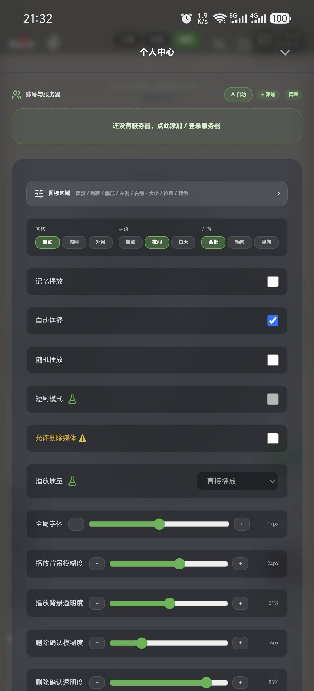
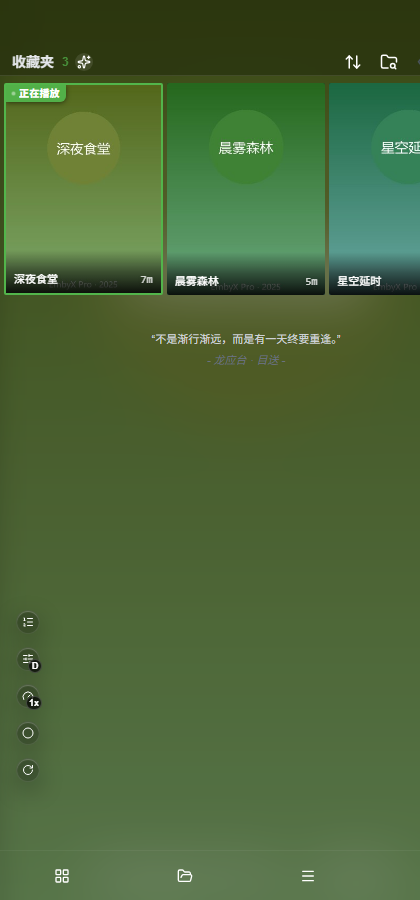
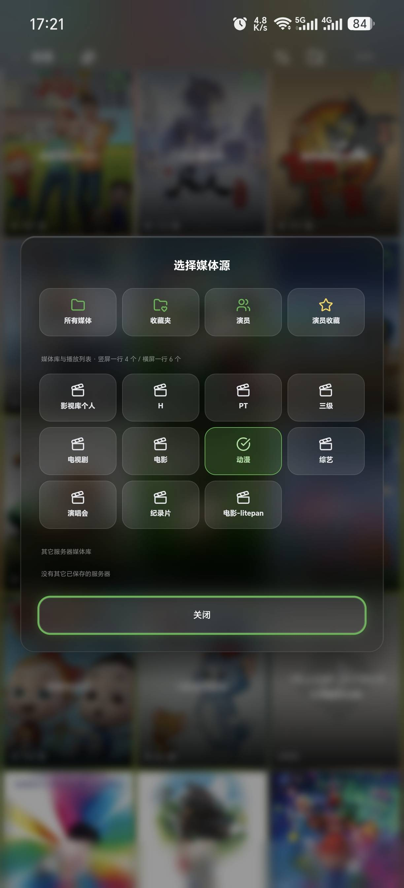
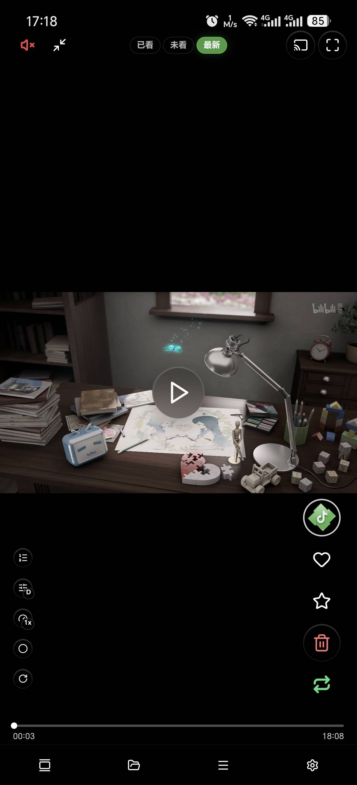

# EmbyX Pro

基于 [juneix/EmbyX](https://github.com/juneix/EmbyX)（MIT License）深度定制的客户端正式发行版。

> 本项目遵循上游 MIT 许可，保留原始版权声明（见 [LICENSE](./LICENSE)）。
> 上游原版说明见 [README_UPSTREAM.md](./README_UPSTREAM.md)。

| 项目 | 说明 |
|---|---|
| 应用名 | `EmbyX Pro` |
| applicationId | `com.embypro.egglab` |
| versionName / versionCode | `2.1.15` / `139` |
| 前端 | 原生 JS（`zh/`），无框架 |
| 原生壳 | Capacitor 8 + Android（`android/`） |
| 签名 | 详见下方「签名配置」 |

---

## 下载

最新正式版见 [Releases](https://github.com/tangzimeng/embyxpro/releases)：

| 平台 | 文件 | 说明 |
|---|---|---|
| Android | `embypro-v2.1.15.apk` | 已签名，直接安装；与上游包可并存 |
| Windows | `EmbyXPro-Portable.exe` | 单文件便携版，双击即用，免安装 |

Windows 版所有数据统一存放在 exe 同级的 `EmbyXProData/`：登录态、偏好、缓存、日志、临时文件都在里面，
不写 `%APPDATA%` / `%LOCALAPPDATA%` / `%TEMP%`；升级只替换 exe，数据原样保留。
迁移只需拷贝「exe + 数据夹」两样。

---

## 界面预览

| | |
|---|---|
|  |  |
| **个人中心**：账号与服务器管理（多服务器卡片、编辑/设为主/一键删除）+ 全局设置 | **宫格视图**：海报墙 + 时长/进度标注 + 「正在播放」标记 |
|  |  |
| **选择媒体源**：所有媒体 / 收藏夹 / 演员 / 演员收藏 + 媒体库与播放列表网格 | **播放界面**：播放列表 / 收藏 / 五角星添加 / 观看状态 / 刷新连接 / 删除等快捷按钮 |

## 与上游 EmbyX 的差异

本仓库在上游基础上做了长期的功能定制与体验优化，主要差异如下。

### 品牌

- 应用名 `EmbyX Pro`，包名 `com.embypro.egglab`，与上游官方包（`juneix.embyx`）相互独立，可并存安装。

### 播放与交互

- **长按头像**：进入当前视频所在文件夹（最深非聚合祖先，`Recursive=false`）并自动定位到该视频；
- **多选手势**：视频列表纵向滑动 = 原生滚动浏览，横向（含横向占优的斜向滑动）= 快速连选，方向一次判定锁定；
- **播放界面增加**：五角星按钮（添加到播放列表）、固定倍速开关、视频观看状态、刷新连接、画质等按钮；
- **服务器管理**：同一服务器的内外网地址保留为独立卡片（`findSameMachine`），仅按主地址精确合并；
- **全量备份 / 恢复**（`js/backup.js`）：遍历全部偏好键（含黑名单过滤），恢复出厂默认保留服务器与登录态。

### 界面与设置

- **图标管理**：图标大小、间距、开关等调整；
- **缓存设置、媒体可见性设置**等；
- 横屏自适应布局、文件夹导航、演员库及收藏、媒体库多入口。
## 目录结构

```
zh/                    前端（HTML / JS / CSS / 图片）
android/               Capacitor 安卓原生工程
  app/src/main/java/   原生壳 MainActivity（含状态栏桥接）
  app/src/main/assets/ 构建时由脚本同步前端产物
docker/                Docker 构建与部署（nginx 静态托管 Web 版）
scripts/               上游部署脚本
pic/                   界面截图与宣传图
capacitor.config.json  Capacitor 配置
```

## 构建

**环境要求**：JDK 21、Android SDK（compileSdk 34）、Node.js 18+。

```bash
# 1. 安装依赖
npm install

# 2. 同步前端到安卓工程
#    （等价 npx cap copy android，仅覆盖不删除）
python sync_zh.py

# 3. 构建签名 APK
cd android
./gradlew assembleRelease
# 产物：android/app/build/outputs/apk/release/app-release.apk
```

> `sync_zh.py` 等价 `npx cap copy android`，把 `zh/` 复制到
> `android/app/src/main/assets/public/`，不删除 Capacitor 生成的 cordova 文件。

## Docker 部署

镜像由 GitHub Actions 在云端从本仓库源码自动构建，并推送到 GHCR。在设备上直接拉取即可运行，无需登录、无需本机编译：

```bash
# 直接拉取已构建好的镜像并启动（Web 版，包含本项目全部定制功能）
docker compose -f docker/docker-compose.yml up -d

# 或手动拉取运行
docker pull ghcr.io/tangzimeng/embyxpro:latest
docker run -d --name embyxpro --restart unless-stopped --network host -e APP_LANG=zh -e APP_PORT=8090 ghcr.io/tangzimeng/embyxpro:latest
```

访问 `http://设备IP:8090`。中文/英文由 `APP_LANG` 控制（默认 zh）。.
yml文件
services:
  embyx:
    # 镜像由本仓库 .github/workflows/build-docker.yml 在云端自动构建并推送到 GHCR
    # 直接拉取即可，无需登录、无需本机编译（含本项目全部定制功能）
    image: ghcr.io/tangzimeng/embyxpro:latest
    container_name: embyxpro
    restart: unless-stopped
    network_mode: host
    environment:
      - APP_LANG=zh # zh (中文), en (English)
      - APP_PORT=8090 # 访问端口 (Access Port)
      
## 签名配置

本仓库**不包含任何密钥或口令**。`android/app/build.gradle` 的签名配置从环境变量读取，
构建前需自行设置：

| 环境变量 | 含义 |
|---|---|
| `SIGNING_STORE_PASSWORD` | keystore 口令 |
| `SIGNING_KEY_PASSWORD` | key 口令 |
| `SIGNING_KEYSTORE_PATH` | keystore 路径（可选，默认 `../keystore/embytok.jks`） |

未提供 keystore 时，可将 `build.gradle` 的 `signingConfig` 换成 `signingConfigs.debug`
或使用未签名构建（`assembleRelease` 仍需签名配置，可临时改用 `assembleDebug`）。

## 免责声明

本项目为个人二次定制，与上游 [juneix/EmbyX](https://github.com/juneix/EmbyX) 无隶属关系,仍保留原作者彩蛋空间相关功能。
使用需自行准备 Emby / Jellyfin 服务器。请在遵守当地法律法规的前提下使用。
